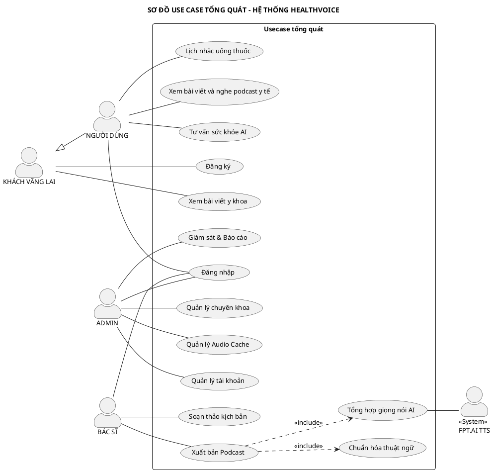
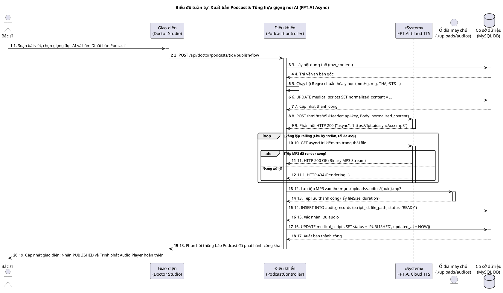
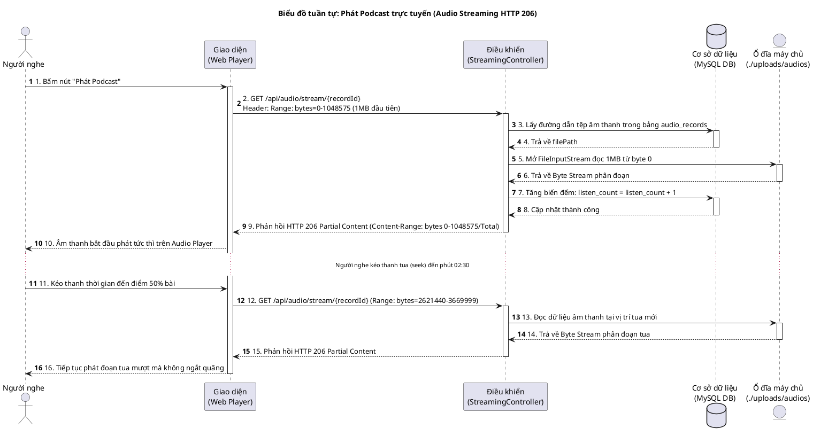
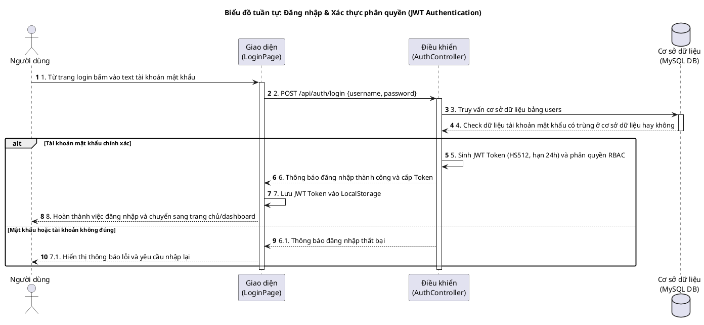
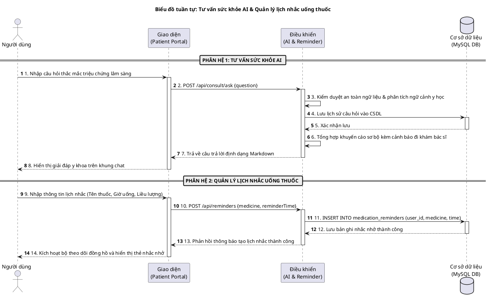
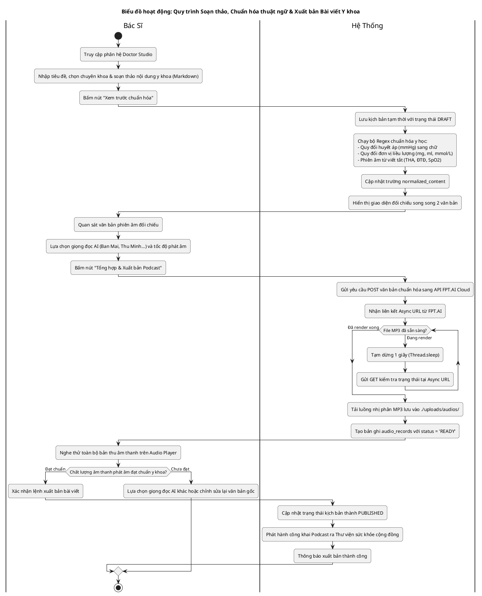
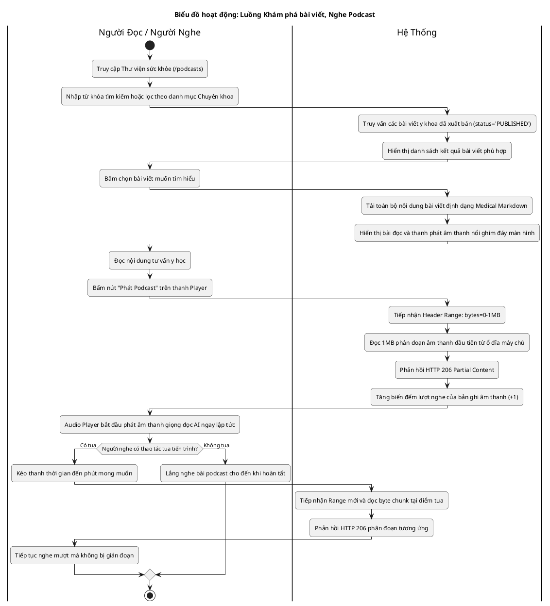
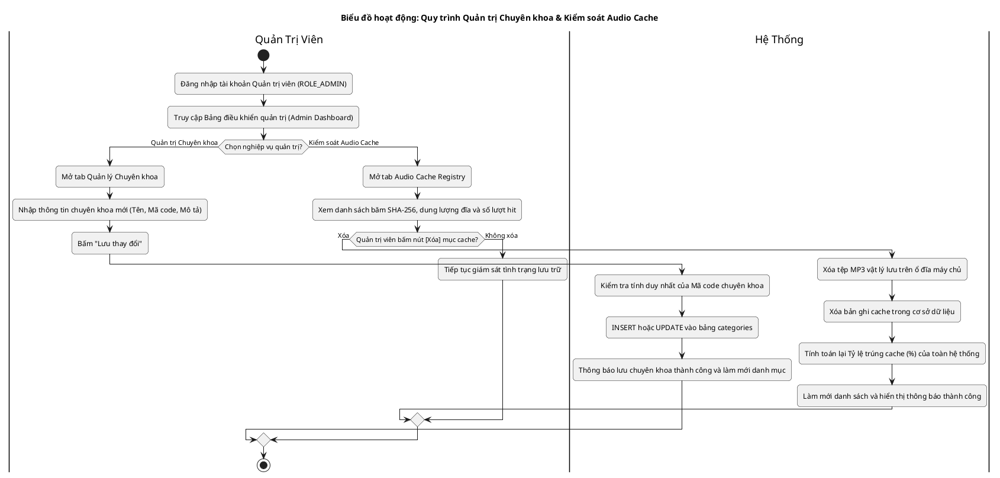
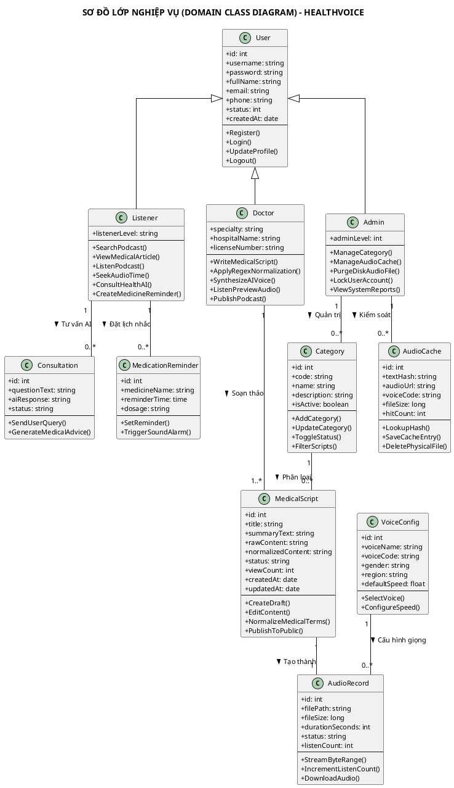
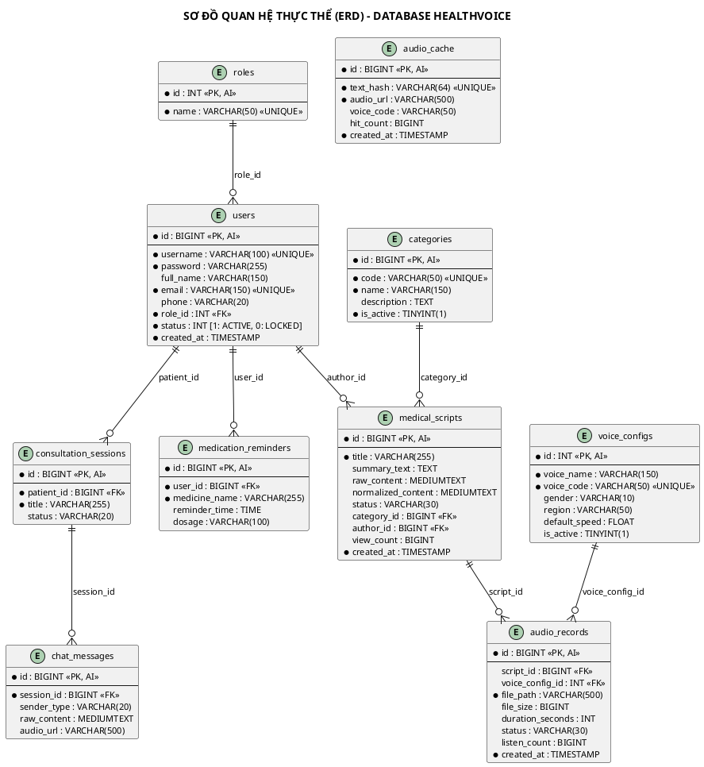

# 🏥 BÁO CÁO ĐỒ ÁN TỐT NGHIỆP / CƠ SỞ NGÀNH CÔNG NGHỆ THÔNG TIN
## ĐỀ TÀI: NGHIÊN CỨU & XÂY DỰNG HỆ THỐNG XUẤT BẢN NỘI DUNG TƯ VẤN SỨC KHỎE VÀ PODCAST GIỌNG ĐỌC AI (HEALTHVOICE 2.0)

**Chuyên ngành:** Kỹ thuật Phần mềm / Công nghệ Thông tin  
**Phương pháp luận:** Phân tích Thiết kế Hệ thống Hướng đối tượng (OOAD) theo chuẩn UML 2.5  
**Nền tảng công nghệ:** Java 21, Spring Boot 3.3.4, React 18, Python FastAPI TTS, FPT.AI Cloud API, MySQL 8.0  

---

# MỤC LỤC TỔNG QUAN

- [CHƯƠNG 1: GIỚI THIỆU TỔNG QUAN ĐỀ TÀI](#chương-1-giới-thiệu-tổng-quan-đề-tài)
  - [1.1. Bối cảnh và Tính cấp thiết](#11-bối-cảnh-và-tính-cấp-thiết)
  - [1.2. Mục tiêu nghiên cứu và giải pháp đề xuất](#12-mục-tiêu-nghiên-cứu-và-giải-pháp-đề-xuất)
  - [1.3. Đối tượng và Phạm vi áp dụng](#13-đối-tượng-và-phạm-vi-áp-dụng)
- [CHƯƠNG 2: CƠ SỞ LÝ THUYẾT VÀ CÔNG NGHỆ ÁP DỤNG](#chương-2-cơ-sở-lý-thuyết-và-công-nghệ-áp-dụng)
  - [2.1. Kiến trúc phân tầng Microservices & 4-Tier Architecture](#21-kiến-trúc-phân-tầng-microservices--4-tier-architecture)
  - [2.2. Công nghệ Backend & Bảo mật Stateless (Spring Boot 3 + JWT)](#22-công-nghệ-backend--bảo-mật-stateless-spring-boot-3--jwt)
  - [2.3. Công nghệ Xử lý Ngôn ngữ & Tổng hợp Giọng nói Y khoa (FPT.AI TTS)](#23-công-nghệ-xử-lý-ngôn-ngữ--tổng-hợp-giọng-nói-y-khoa-fptai-tts)
  - [2.4. Cơ chế Phân phối Âm thanh Trực tuyến HTTP 206 Partial Content](#24-cơ-chế-phân-phối-âm-thanh-trực-tuyến-http-206-partial-content)
  - [2.5. Giải pháp Bộ nhớ đệm Âm thanh SHA-256 Audio Cache](#25-giải-pháp-bộ-nhớ-đệm-âm-thanh-sha-256-audio-cache)
- [CHƯƠNG 3: PHÂN TÍCH VÀ ĐẶC TẢ YÊU CẦU HỆ THỐNG (UML 2.5)](#chương-3-phân-tích-và-đặc-tả-yêu-cầu-hệ-thống-uml-25)
  - [3.1. Xác định Tác nhân (Actors)](#31-xác-định-tác-nhân-actors)
  - [3.2. Sơ đồ Use Case Tổng quát (Overall Use Case Diagram)](#32-sơ-đồ-use-case-tổng-quát)
  - [3.3. Ma trận Ánh xạ 14 Use Case Nghiệp vụ](#33-ma-trận-ánh-xạ-14-use-case-nghiệp-vụ)
  - [3.4. Bảng Đặc tả Chi tiết các Use Case Trọng tâm](#34-bảng-đặc-tả-chi-tiết-các-use-case-trọng-tâm)
- [CHƯƠNG 4: THIẾT KẾ ĐỘNG HỌC & MÔ HÌNH HÓA DỮ LIỆU](#chương-4-thiết-kế-động-học--mô-hình-hóa-dữ-liệu)
  - [4.1. Hệ thống 4 Sơ đồ Tuần tự Trọng tâm (Sequence Diagrams)](#41-hệ-thống-4-sơ-đồ-tuần-tự-trọng-tâm)
  - [4.2. Hệ thống 3 Sơ đồ Hoạt động Phân làn (Activity Diagrams)](#42-hệ-thống-3-sơ-đồ-hoạt-động-phân-làn)
  - [4.3. Sơ đồ Lớp Lĩnh vực Nghiệp vụ (Domain Class Diagram)](#43-sơ-đồ-lớp-lĩnh-vực-nghiệp-vụ)
  - [4.4. Sơ đồ Thực thể Liên kết Cơ sở Dữ liệu (ERD MySQL)](#44-sơ-đồ-thực-thể-liên-kết-cơ-sở-dữ-liệu)
- [CHƯƠNG 5: CÀI ĐẶT, THỰC THI VÀ KẾT QUẢ ĐẠT ĐƯỢC](#chương-5-cài-đặt-thực-thi-và-kết-quả-đạt-được)
  - [5.1. Môi trường Triển khai & Cấu trúc Mã nguồn](#51-môi-trường-triển-khai--cấu-trúc-mã-nguồn)
  - [5.2. Các Giao diện Nghiệp vụ Chính của Ứng dụng](#52-các-giao-diện-nghiệp-vụ-chính-của-ứng-dụng)
  - [5.3. Đánh giá Hiệu năng & Thử nghiệm Thực tế](#53-đánh-giá-hiệu-năng--thử-nghiệm-thực-tế)
- [CHƯƠNG 6: KẾT LUẬN VÀ HƯỚNG PHÁT TRIỂN](#chương-6-kết-luận-và-hướng-phát-triển)
  - [6.1. Các kết quả đã hoàn thành](#61-các-kết-quả-đã-hoàn-thành)
  - [6.2. Hạn chế của đề tài](#62-hạn-chế-của-đề-tài)
  - [6.3. Kế hoạch nghiên cứu mở rộng](#63-kế-hoạch-nghiên-cứu-mở-rộng)

---

# CHƯƠNG 1: GIỚI THIỆU TỔNG QUAN ĐỀ TÀI

### 1.1. Bối cảnh và Tính cấp thiết
Trong kỷ nguyên chuyển đổi số y tế, nhu cầu tìm hiểu thông tin sức khỏe, chăm sóc người bệnh mạn tính và phòng ngừa tai biến tại nhà của người dân Việt Nam ngày càng tăng cao. Tuy nhiên, các phương tiện truyền thông y tế hiện nay đang bộc lộ nhiều điểm nghẽn nghiêm trọng:
1. **Rào cản tiếp cận thị giác**: Độc giả là người cao tuổi, người có thị lực suy giảm, hoặc bệnh nhân đang trong trạng thái mệt mỏi rất khó tiếp cận các bài đọc y khoa dài dằng dặc trên màn hình điện thoại/máy tính.
2. **Sai lệch nghiêm trọng của công nghệ đọc văn bản thông thường (TTS)**: Các bộ đọc tổng hợp giọng nói đại trà khi đọc tài liệu y khoa thường phát âm sai hoàn toàn các đơn vị đo lâm sàng (*"120/80 mmHg"*, *"500mg"*, *"5.5 mmol/L"*), đọc nhầm các thuật ngữ viết tắt (*"THA"*, *"ĐTĐ"*, *"SpO2"*) dẫn đến nguy cơ hiểu lầm liều dùng và hướng dẫn điều trị.
3. **Chi phí và độ trễ tạo âm thanh lớn**: Việc gọi các dịch vụ AI đám mây trực tiếp mỗi khi có người nghe làm tăng đột biến chi phí bản quyền và gây ra độ trễ từ 3 đến 8 giây cho mỗi tệp âm thanh dài.

Xuất phát từ thực tiễn trên, đề tài **"HealthVoice 2.0 - Nền tảng Đa phương tiện Xuất bản Nội dung Tư vấn Sức khỏe & Podcast Giọng đọc AI"** được nghiên cứu và hiện thực hóa nhằm mang lại một giải pháp truyền thông y tế hiện đại, đáng tin cậy và có khả năng tương tác cao.

### 1.2. Mục tiêu nghiên cứu và giải pháp đề xuất
Đề tài tập trung giải quyết 4 mục tiêu công nghệ cốt lõi:
- **Xây dựng Thư viện Podcast Y khoa Đa chuyên khoa**: Cho phép người bệnh dễ dàng khám phá, đọc bài viết định dạng Medical Markdown và nghe các bản podcast chất lượng cao được biên soạn bởi bác sĩ chuyên khoa.
- **Phát triển Công cụ Chuẩn hóa Ngữ âm Y học Tự động (Medical Text Normalizer)**: Sử dụng các quy tắc biểu thức chính quy (Regex) chuyên sâu để tự động chuyển đổi số đo huyết áp, liều lượng thuốc, nhịp tim và tên bệnh lý viết tắt sang văn bản phiên âm phát âm tiếng Việt chuẩn xác trước khi đưa vào mô hình tổng hợp giọng nói.
- **Tích hợp Công nghệ Tổng hợp Giọng nói AI Đám mây (FPT.AI Cloud TTS)**: Ứng dụng cơ chế xử lý bất đồng bộ (Asynchronous Polling) để chuyển đổi kịch bản thành giọng đọc truyền cảm (Ban Mai, Thu Minh, Gia Huy...) mang đậm âm hưởng địa phương (Bắc, Trung, Nam).
- **Tối ưu hóa Phân phối Âm thanh với HTTP 206 Streaming & SHA-256 Audio Cache**: Cho phép người nghe phát âm thanh tức thì không độ trễ (<0.2s), hỗ trợ tua nhanh mượt mà và tiết kiệm hơn 90% chi phí điện toán nhờ cơ chế tái sử dụng tệp âm thanh trùng lặp.

### 1.3. Đối tượng và Phạm vi áp dụng
- **Khách vãng lai**: Xem danh mục chuyên khoa, đọc bài viết hướng dẫn y tế công khai.
- **Người dùng / Bệnh nhân (`ROLE_LISTENER`)**: Đăng ký, đăng nhập, vừa đọc bài viết vừa nghe podcast âm thanh, trò chuyện hỏi đáp sức khỏe với AI, thiết lập lịch nhắc uống thuốc theo phác đồ.
- **Bác sĩ chuyên khoa (`ROLE_DOCTOR`)**: Sử dụng phân hệ Doctor Studio để soạn thảo kịch bản, xem trước đối soát văn bản chuẩn hóa, tổng hợp file âm thanh qua FPT.AI, nghe thử kiểm định và xuất bản podcast ra thư viện.
- **Quản trị viên (`ROLE_ADMIN`)**: Quản lý danh mục chuyên khoa, kiểm soát tài khoản người dùng, giám sát báo cáo số liệu và quản lý dọn dẹp kho lưu trữ âm thanh Audio Cache.

---

# CHƯƠNG 2: CƠ SỞ LÝ THUYẾT VÀ CÔNG NGHỆ ÁP DỤNG

### 2.1. Kiến trúc phân tầng Microservices & 4-Tier Architecture
Hệ thống HealthVoice 2.0 được tổ chức theo mô hình kiến trúc phân tầng chuyên nghiệp:

```
┌─────────────────────────────────────────────────────────────┐
│ 1. CLIENT TIER: React 18 + Tailwind CSS + Web Audio Player │
└──────────────────────────────┬──────────────────────────────┘
                               │ RESTful API (JSON + JWT)
┌──────────────────────────────▼──────────────────────────────┐
│ 2. BACKEND CORE: Spring Boot 3.3.4 (Java 21)               │
│    - Security & JWT Auth      - Script & Category Controller│
│    - Text Normalization Regex - Audio Streaming (HTTP 206)  │
└──────────────┬──────────────────────────────┬───────────────┘
               │ JPA / Hibernate              │ Async HTTP / REST
┌──────────────▼──────────────┐ ┌─────────────▼───────────────┐
│ 3. DATABASE TIER            │ │ 4. EXTERNAL AI TIER         │
│ MySQL 8.0 (InnoDB, UTF8mb4) │ │ FPT.AI Cloud TTS (REST API) │
│ - 8 Bảng chuẩn hóa 3NF      │ │ ./uploads/audios/ (Disk)    │
└─────────────────────────────┘ └─────────────────────────────┘
```

### 2.2. Công nghệ Backend & Bảo mật Stateless (Spring Boot 3 + JWT)
- **Spring Boot 3.3.4 & Java 21**: Tận dụng cơ chế Virtual Threads và tính năng Records của Java hiện đại để xử lý đa luồng tải cao khi streaming âm thanh.
- **Spring Security 6 & JWT HS512**: Thực hiện cơ chế xác thực vô trạng thái (Stateless Authentication). Mọi yêu cầu được ký số và đóng gói trong mã JWT có thời hạn 24 giờ.
- **Mã hóa BCrypt**: Mật khẩu người dùng được băm một chiều với độ phức tạp cao (`WorkFactor = 10`), ngăn chặn nguy cơ tấn công từ điển và dò quét Rainbow Table.

### 2.3. Công nghệ Xử lý Ngôn ngữ & Tổng hợp Giọng nói Y khoa (FPT.AI TTS)
- **Cơ chế Xử lý Bất đồng bộ (Async Polling)**: Khi văn bản có dung lượng lớn, API `https://api.fpt.ai/hmi/tts/v5` sẽ phản hồi ngay lập tức mã HTTP 200 kèm đường dẫn Async URL. Backend thiết lập vòng lặp Polling (chu kỳ 1 giây/lần, timeout 45 giây) để đợi tệp MP3 nhị phân kết xuất xong thì tải về lưu trữ cục bộ.
- **Bộ chuẩn hóa ngữ âm y học (Medical Regex Rules)**:
  - Chỉ số huyết áp: `(\d+)/(\d+)\s*mmHg` $\rightarrow$ *"một trăm hai mươi trên tám mươi mi-li-mét thủy ngân"*.
  - Liều lượng dạng khối lượng/thể tích: `(\d+)\s*mg` $\rightarrow$ *"năm trăm mi-li-gam"*, `(\d+)\s*ml` $\rightarrow$ *"mười mi-li-lít"*.
  - Chỉ số sinh hóa máu: `(\d+(\.\d+)?)\s*mmol/L` $\rightarrow$ *"năm phẩy năm mi-li-mol trên lít"*.
  - Bệnh lý viết tắt: `THA` $\rightarrow$ *"tăng huyết áp"*, `ĐTĐ` $\rightarrow$ *"đái tháo đường"*, `SpO2` $\rightarrow$ *"độ bão hòa oxy trong máu"*.

### 2.4. Cơ chế Phân phối Âm thanh Trực tuyến HTTP 206 Partial Content
Thay vì gửi toàn bộ tệp MP3 (thường nặng từ 3MB - 10MB) khiến người nghe phải chờ tải xong mới phát được, máy chủ Backend áp dụng giao thức **HTTP 206 Partial Content**:
- Khi người nghe bấm phát, trình duyệt gửi Header `Range: bytes=0-1048575` (yêu cầu phân đoạn 1MB đầu tiên).
- Máy chủ đọc luồng byte từ ổ đĩa và phản hồi HTTP 206 kèm `Content-Range: bytes 0-1048575/TotalBytes`.
- Khi người nghe tua nhanh (seek) đến giữa bài, trình duyệt gửi `Range: bytes=2621440-...`. Máy chủ nhảy trực tiếp đến vị trí byte tương ứng và tiếp tục streaming mà không cần tải lại các đoạn trước đó.

### 2.5. Giải pháp Bộ nhớ đệm Âm thanh SHA-256 Audio Cache
Mỗi đoạn văn bản yêu cầu đọc âm thanh được băm bằng thuật toán SHA-256:
$$\text{TextHash} = \text{SHA256}(\text{NormalizedContent} + \text{VoiceCode} + \text{Speed})$$
Nếu chuỗi băm đã tồn tại trong bảng `audio_cache`, hệ thống trả về ngay lập tức đường dẫn tệp âm thanh đã có trong 15ms mà không cần gửi yêu cầu tổng hợp tốn phí sang FPT.AI Cloud.

---

# CHƯƠNG 3: PHÂN TÍCH VÀ ĐẶC TẢ YÊU CẦU HỆ THỐNG (UML 2.5)

### 3.1. Xác định Tác nhân (Actors)
1. **`KHÁCH VÃNG LAI`**: Người dùng chưa có tài khoản, có quyền đọc các bài viết y khoa công khai và đăng ký tài khoản.
2. **`NGƯỜI DÙNG` (Người bệnh)**: Kế thừa từ Khách vãng lai, sau khi đăng nhập có thêm quyền nghe podcast trực tuyến, hỏi đáp sức khỏe với AI và tạo lịch nhắc uống thuốc.
3. **`BÁC SĨ`**: Chuyên gia y tế có thẩm quyền biên tập bài viết, chuẩn hóa thuật ngữ, thử nghiệm giọng đọc AI và xuất bản podcast ra cộng đồng.
4. **`ADMIN`**: Quản trị viên phụ trách cấu hình hệ thống, quản lý chuyên khoa, kiểm soát kho bộ nhớ đệm Audio Cache và giám sát chỉ số hoạt động.
5. **`<<System>> FPT.AI TTS`**: Hệ thống dịch vụ đám mây bên ngoài cung cấp API chuyển văn bản thành giọng nói tiếng Việt tự nhiên.

### 3.2. Sơ đồ Use Case Tổng quát
*(Thiết kế chuẩn hóa đối xứng 14 Use Cases theo đúng bản vẽ kiến trúc của đề tài)*



### 3.3. Bảng Tổng hợp Danh sách 14 Use Case Hệ thống

Bảng danh mục dưới đây tổng hợp đầy đủ 100% các chức năng trên Sơ đồ Use Case tổng thể:

| Mã UC | Tên Use Case | Tác Nhân Chính | Mô Tả Ngắn Gọn Nghiệp Vụ | Mức Độ Đặc Tả |
| :---: | :--- | :--- | :--- | :---: |
| **UC01** | **Đăng ký** | Khách vãng lai | Khách vãng lai tạo tài khoản mới trên hệ thống, mật khẩu được mã hóa BCrypt. | *Bảng tổng hợp* |
| **UC02** | **Xem bài viết y khoa** | Khách vãng lai | Xem danh sách và nội dung bài viết tư vấn y khoa công khai định dạng Markdown. | *Bảng tổng hợp* |
| **UC03** | **Đăng nhập** | Người dùng, Bác sĩ, Admin | Xác thực định danh qua username/password, cấp JWT Token phân quyền RBAC hạn 24h. | **Đặc tả chi tiết** |
| **UC04** | **Xem bài viết và nghe podcast y tế** | Người dùng | Vừa đọc nội dung y khoa vừa phát âm thanh trực tuyến HTTP 206 Partial Content (tua nhanh). | **Đặc tả chi tiết** |
| **UC05** | **Tư vấn sức khỏe AI** | Người dùng | Hỏi đáp triệu chứng lâm sàng tức thì, AI phân tích và đưa ra khuyến cáo y khoa sơ bộ. | **Đặc tả chi tiết** |
| **UC06** | **Lịch nhắc uống thuốc** | Người dùng | Cài đặt giờ uống thuốc, liều lượng và nhận chuông báo âm thanh nhắc nhở đúng giờ. | **Đặc tả chi tiết** |
| **UC07** | **Soạn thảo kịch bản** | Bác sĩ | Bác sĩ tạo bài viết y khoa mới, biên tập nội dung chuyên môn bằng Medical Markdown. | **Đặc tả chi tiết** |
| **UC08** | **Xuất bản Podcast** | Bác sĩ | Chu trình xuất bản: tự động Chuẩn hóa Regex (UC09) + Tổng hợp FPT.AI (UC10) + Phát hành. | **Đặc tả chi tiết** |
| **UC09** | **Chuẩn hóa thuật ngữ** | Hệ thống (Bác sĩ kiểm soát)| Regex tự động quy đổi chỉ số lâm sàng (mmHg, mg, mmol/L) và từ viết tắt sang chữ. | *Gộp vào UC08* |
| **UC10** | **Tổng hợp giọng nói AI** | Bác sĩ, FPT.AI TTS | Gửi văn bản sang FPT.AI Cloud API, Polling nhận file MP3 lưu đĩa máy chủ. | *Gộp vào UC08* |
| **UC11** | **Quản lý chuyên khoa** | Quản trị viên (Admin) | Thêm mới, chỉnh sửa thông tin, ẩn/hiện các danh mục chuyên khoa y tế. | *Bảng tổng hợp* |
| **UC12** | **Quản lý Audio Cache** | Quản trị viên (Admin) | Tra cứu băm SHA-256, xóa file âm thanh vật lý trên đĩa máy chủ để giải phóng dung lượng. | **Đặc tả chi tiết** |
| **UC13** | **Quản lý tài khoản** | Quản trị viên (Admin) | Quản lý người dùng, phân quyền vai trò (Listener, Doctor) hoặc khóa/mở khóa tài khoản. | *Bảng tổng hợp* |
| **UC14** | **Giám sát & Báo cáo** | Quản trị viên (Admin) | Thống kê số liệu hệ thống: lượt nghe, dung lượng ổ đĩa, tỷ lệ trúng cache, độ trễ API. | **Đặc tả chi tiết** |

### 3.4. Bảng Đặc tả Chi tiết 8 Use Case Cốt lõi (Full Specifications)

#### 1. Đặc tả UC03: Đăng nhập
| Thuộc tính | Chi tiết đặc tả |
| :--- | :--- |
| **\*Use Case ID:** | `UC03` |
| **\*Use Case Name:** | **Đăng nhập** |
| **\*Description:** | Xác thực định danh người dùng (Người dùng, Bác sĩ, Quản trị viên) qua Tên đăng nhập và Mật khẩu, cấp mã JWT Token để phân quyền RBAC truy cập hệ thống. |
| **\*Actors:** | Người dùng, Bác sĩ, Quản trị viên (Admin). |
| **\*Trigger:** | Tác nhân nhấn nút "Đăng nhập" trên giao diện hoặc truy cập `/login`. |
| **\*Pre-Conditions:** | Tác nhân đã có tài khoản hợp lệ trên hệ thống HealthVoice. |
| **\*Post-Condition:** | - Cấp JWT Token có thời hạn 24h lưu vào LocalStorage.<br>- Điều hướng người dùng vào trang chủ hoặc phân hệ chuyên trách theo vai trò. |
| **\*Basic Flow:** | **Tác nhân:**<br>1. Từ trang login, bấm vào ô tài khoản và mật khẩu.<br>2. Nhập chính xác tên đăng nhập và mật khẩu.<br>3. Bấm chọn nút "Đăng nhập".<br><br>**Hệ thống:**<br>4. Lấy tài khoản và mật khẩu từ giao diện gửi lên.<br>5. Truy vấn CSDL bảng `users` theo tên đăng nhập.<br>6. Check dữ liệu tài khoản mật khẩu có trùng ở CSDL hay không bằng `BCryptPasswordEncoder`.<br>7. Kiểm tra trạng thái tài khoản đang hoạt động (`status = 1`).<br>8. Sinh JWT Token chứa thông tin username và role.<br>9. Thông báo đăng nhập thành công và chuyển sang trang chủ/dashboard.<br>10. Hoàn thành việc đăng nhập. |
| **\*Exception Flow:** | 6.1. Tài khoản không tồn tại hoặc sai mật khẩu: Hệ thống thông báo lỗi và yêu cầu nhập lại. |

#### 2. Đặc tả UC04: Xem bài viết và nghe podcast y tế
| Thuộc tính | Chi tiết đặc tả |
| :--- | :--- |
| **\*Use Case ID:** | `UC04` |
| **\*Use Case Name:** | **Xem bài viết và nghe podcast y tế** |
| **\*Description:** | Người dùng vừa đọc nội dung y khoa, vừa nghe podcast âm thanh giọng đọc AI qua cơ chế streaming HTTP 206 Partial Content (tua nhanh tức thì). |
| **\*Actors:** | Người dùng. |
| **\*Trigger:** | Người dùng mở một bài viết y khoa và bấm nút "Phát Podcast". |
| **\*Pre-Conditions:** | Người dùng đã đăng nhập; bài viết có trạng thái `PUBLISHED` và tệp âm thanh có trạng thái `READY`. |
| **\*Post-Condition:** | Âm thanh giọng đọc AI phát mượt mà không trễ (<0.2s); biến đếm `listen_count` tăng thêm 1. |
| **\*Basic Flow:** | **Người dùng:**<br>1. Mở bài viết y khoa cần tìm hiểu.<br>2. Đọc nội dung và quan sát thanh Player ghim đáy màn hình.<br>3. Bấm nút "Phát Podcast".<br>4. Kéo thanh tua thời gian đến phút mong muốn.<br><br>**Hệ thống:**<br>5. Gửi yêu cầu `GET /api/audio/stream/{recordId}` kèm Header `Range: bytes=0-1048575` (1MB đầu tiên).<br>6. Đọc phân đoạn byte âm thanh đầu tiên từ ổ đĩa máy chủ.<br>7. Phản hồi mã `HTTP 206 Partial Content` kèm luồng dữ liệu nhị phân MP3.<br>8. Tăng biến đếm lượt nghe `listen_count = listen_count + 1`.<br>9. Trình phát âm thanh phát ngay lập tức không cần tải toàn bộ tệp.<br>10. Khi tua thời gian, hệ thống gửi Range mới và phản hồi phân đoạn tương ứng mượt mà. |
| **\*Exception Flow:** | 6.1. Tệp âm thanh bị lỗi hoặc mất tệp: Hệ thống cảnh báo tệp bảo trì và giữ nguyên bài đọc văn bản. |

#### 3. Đặc tả UC05: Tư vấn sức khỏe AI
| Thuộc tính | Chi tiết đặc tả |
| :--- | :--- |
| **\*Use Case ID:** | `UC05` |
| **\*Use Case Name:** | **Tư vấn sức khỏe AI** |
| **\*Description:** | Khung chat AI thông minh hỗ trợ người bệnh hỏi đáp triệu chứng sức khỏe, phân tích ngữ cảnh và đưa ra lời khuyên y khoa sơ bộ. |
| **\*Actors:** | Người dùng. |
| **\*Trigger:** | Người dùng mở giao diện "Tư vấn sức khỏe AI" (`/chat`) và gửi câu hỏi. |
| **\*Pre-Conditions:** | Người dùng đã đăng nhập vào hệ thống. |
| **\*Post-Condition:** | Lưu lịch sử câu hỏi/câu trả lời vào CSDL; hiển thị khuyến cáo định dạng Markdown kèm thông điệp miễn trừ trách nhiệm. |
| **\*Basic Flow:** | **Người dùng:** 1. Mở khung chat. 2. Nhập triệu chứng. 3. Bấm Gửi câu hỏi.<br>**Hệ thống:** 4. Kiểm duyệt an toàn ngữ liệu đầu vào. 5. Phân tích ngữ cảnh y học. 6. Lưu câu hỏi vào CSDL. 7. Trả về câu trả lời Markdown (nhận định sơ bộ, lời khuyên chăm sóc, dấu hiệu nguy hiểm và khuyến nghị đi khám). |
| **\*Exception Flow:** | 4.1. Câu hỏi rỗng hoặc chứa từ ngữ cấm: Hệ thống cảnh báo nhắc nhở. |

#### 4. Đặc tả UC06: Lịch nhắc uống thuốc
| Thuộc tính | Chi tiết đặc tả |
| :--- | :--- |
| **\*Use Case ID:** | `UC06` |
| **\*Use Case Name:** | **Lịch nhắc uống thuốc** |
| **\*Description:** | Người dùng thiết lập danh sách thuốc điều trị theo giờ trong ngày, nhận thông báo chuông báo âm thanh đúng giờ. |
| **\*Actors:** | Người dùng. |
| **\*Trigger:** | Người dùng mở trang "Lịch nhắc uống thuốc" (`/reminders`) và bấm "Thêm lịch nhắc". |
| **\*Pre-Conditions:** | Người dùng đã đăng nhập tài khoản. |
| **\*Post-Condition:** | Lưu bản ghi vào CSDL (`medication_reminders`); kích hoạt bộ theo dõi giờ báo thức. |
| **\*Basic Flow:** | **Người dùng:** 1. Vào Lịch nhắc. 2. Bấm Thêm mới. 3. Điền Tên thuốc, Giờ uống, Liều lượng, Ghi chú. 4. Bấm Lưu.<br>**Hệ thống:** 5. Kiểm tra tính hợp lệ dữ liệu. 6. Lưu vào CSDL liên kết ID người dùng. 7. Kích hoạt bộ theo dõi giờ và thông báo lưu thành công. |
| **\*Exception Flow:** | 5.1. Bỏ trống thông tin thuốc: Hệ thống hiển thị cảnh báo yêu cầu nhập đầy đủ. |

#### 5. Đặc tả UC07: Soạn thảo kịch bản
| Thuộc tính | Chi tiết đặc tả |
| :--- | :--- |
| **\*Use Case ID:** | `UC07` |
| **\*Use Case Name:** | **Soạn thảo kịch bản** |
| **\*Description:** | Bác sĩ tạo bài viết y khoa mới, biên tập nội dung định dạng Medical Markdown trên Doctor Studio. |
| **\*Actors:** | Bác sĩ. |
| **\*Trigger:** | Bác sĩ bấm nút "Tạo kịch bản mới" trên cổng Doctor Studio (`/doctor`). |
| **\*Pre-Conditions:** | Bác sĩ đã đăng nhập với vai trò `ROLE_DOCTOR`. |
| **\*Post-Condition:** | Bản ghi kịch bản mới được lưu vào bảng `medical_scripts` với trạng thái `DRAFT`. |
| **\*Basic Flow:** | **Bác sĩ:** 1. Vào Doctor Studio. 2. Bấm Tạo kịch bản mới. 3. Nhập Tiêu đề, Chuyên khoa, Tóm tắt, Nội dung Markdown. 4. Bấm Lưu bản nháp.<br>**Hệ thống:** 5. Kiểm tra quyền Bác sĩ. 6. Kiểm tra tính đầy đủ thông tin. 7. INSERT vào `medical_scripts` với `status = 'DRAFT'`. 8. Thông báo lưu thành công và cấp mã `id`. |
| **\*Exception Flow:** | 6.1. Bỏ trống tiêu đề hoặc nội dung: Hệ thống yêu cầu điền đầy đủ. |

#### 6. Đặc tả UC08: Xuất bản Podcast (Gộp Include: Chuẩn hóa Regex & FPT.AI TTS)
| Thuộc tính | Chi tiết đặc tả |
| :--- | :--- |
| **\*Use Case ID:** | `UC08` |
| **\*Use Case Name:** | **Xuất bản Podcast** |
| **\*Description:** | Bác sĩ phát hành bài viết và podcast âm thanh. **Tự động gộp 2 Use Case `<<include>>`**: Chuẩn hóa thuật ngữ Regex (`UC09`) và Tổng hợp giọng nói FPT.AI bất đồng bộ (`UC10`) trước khi chính thức phát hành công khai. |
| **\*Actors:** | Bác sĩ, Hệ thống bên ngoài `<<System>> FPT.AI TTS`. |
| **\*Trigger:** | Bác sĩ bấm nút "Xuất bản Podcast" trên giao diện Doctor Studio. |
| **\*Pre-Conditions:** | Kịch bản y khoa đã có nội dung bài viết thô (`raw_content`). |
| **\*Post-Condition:** | Lưu file MP3 vào `./uploads/audios/`; tạo `audio_records` READY; cập nhật `medical_scripts` sang `PUBLISHED`. |
| **\*Basic Flow:** | **Bác sĩ:**<br>1. Mở bài viết, chọn giọng đọc AI và tốc độ phát âm.<br>2. Bấm "Xuất bản Podcast".<br><br>**Hệ thống:**<br>**[Thực hiện Include: Chuẩn hóa thuật ngữ - UC09]**<br>3. Áp dụng Regex quy đổi chỉ số y học: `120/80 mmHg` $\rightarrow$ *"một trăm hai mươi trên tám mươi mi-li-mét thủy ngân"*; `500mg` $\rightarrow$ *"năm trăm mi-li-gam"*; `THA, ĐTĐ` $\rightarrow$ *"tăng huyết áp, đái tháo đường"*.<br>4. Cập nhật trường `normalized_content`.<br><br>**[Thực hiện Include: Tổng hợp giọng nói AI FPT.AI - UC10]**<br>5. Gửi POST văn bản chuẩn hóa sang API FPT.AI Cloud.<br>6. FPT.AI phản hồi HTTP 200 kèm link Async URL.<br>7. Hệ thống Polling (1s/lần) kiểm tra Async URL.<br>8. FPT.AI render xong, hệ thống tải MP3 nhị phân lưu `./uploads/audios/{uuid}.mp3`.<br>9. INSERT bản ghi mới vào `audio_records` (`status = 'READY'`).<br><br>**[Hoàn tất xuất bản công khai - UC08]**<br>10. Bác sĩ nghe thử kiểm định âm thanh trên Audio Player.<br>11. Cập nhật trạng thái `medical_scripts` thành `PUBLISHED`.<br>12. Phát hành công khai bài viết và Podcast ra Thư viện sức khỏe. |
| **\*Exception Flow:** | 5.1. FPT.AI quá tải: Thông báo dịch vụ bận và cho phép thử lại.<br>7.1. Timeout 45s: Đánh dấu FAILED và thông báo cho Bác sĩ. |

#### 7. Đặc tả UC12: Quản lý Audio Cache
| Thuộc tính | Chi tiết đặc tả |
| :--- | :--- |
| **\*Use Case ID:** | `UC12` |
| **\*Use Case Name:** | **Quản lý Audio Cache** |
| **\*Description:** | Quản trị viên giám sát bộ nhớ đệm âm thanh SHA-256, xem số lượt hit và xóa các file MP3 vật lý trên ổ đĩa để giải phóng dung lượng máy chủ. |
| **\*Actors:** | Quản trị viên (Admin). |
| **\*Trigger:** | Quản trị viên bấm vào tab "Audio Cache" trên Admin Dashboard. |
| **\*Pre-Conditions:** | Đăng nhập với vai trò `ROLE_ADMIN`. |
| **\*Post-Condition:** | File MP3 trên ổ đĩa và bản ghi trong `audio_cache` bị xóa; tính lại tỷ lệ trúng cache (%) của toàn hệ thống. |
| **\*Basic Flow:** | **Quản trị viên:** 1. Mở tab Audio Cache. 2. Xem danh sách hash SHA-256, hit count, dung lượng. 3. Bấm nút [Xóa] mục cache cũ. 4. Xác nhận.<br>**Hệ thống:** 5. Kiểm tra quyền Admin. 6. Lấy đường dẫn file. 7. Xóa file MP3 vật lý trên ổ đĩa bằng `Files.deleteIfExists()`. 8. DELETE bản ghi khỏi `audio_cache`. 9. Tính lại Tỷ lệ trúng cache (%). 10. Làm mới danh sách. |
| **\*Exception Flow:** | 7.1. File vật lý không còn: Vẫn dọn sạch bản ghi mồ côi trong CSDL và cập nhật trạng thái. |

#### 8. Đặc tả UC14: Giám sát & Báo cáo
| Thuộc tính | Chi tiết đặc tả |
| :--- | :--- |
| **\*Use Case ID:** | `UC14` |
| **\*Use Case Name:** | **Giám sát & Báo cáo** |
| **\*Description:** | Tổng hợp các số liệu vận hành hệ thống: lượt nghe podcast, số bài viết xuất bản, người dùng, dung lượng đĩa và tỷ lệ trúng cache. |
| **\*Actors:** | Quản trị viên (Admin). |
| **\*Trigger:** | Quản trị viên truy cập trang Tổng quan của Admin Dashboard (`/admin`). |
| **\*Pre-Conditions:** | Đăng nhập với vai trò `ROLE_ADMIN`. |
| **\*Post-Condition:** | Kết xuất các thẻ chỉ số KPIs và biểu đồ trực quan theo thời gian thực. |
| **\*Basic Flow:** | **Quản trị viên:** 1. Mở trang Tổng quan. 2. Xem các chỉ số KPIs và biểu đồ phân tích. 3. Chọn khoảng thời gian lọc.<br>**Hệ thống:** 4. Truy vấn tổng hợp dữ liệu từ các bảng `users`, `medical_scripts`, `audio_records`, `audio_cache`. 5. Tính toán tỷ lệ trúng cache, dung lượng lưu trữ. 6. Kết xuất biểu đồ trực quan và hiển thị cho Quản trị viên. |
| **\*Exception Flow:** | 4.1. Lỗi kết nối CSDL: Báo lỗi tải thống kê và gợi ý thử lại sau ít phút. |

---

# CHƯƠNG 4: THIẾT KẾ ĐỘNG HỌC & MÔ HÌNH HÓA DỮ LIỆU

### 4.1. Hệ thống 4 Sơ đồ Tuần tự Trọng tâm (Sequence Diagrams)

#### 4.1.1. Sơ đồ tuần tự: Xuất bản Podcast & Tổng hợp giọng nói AI (FPT.AI Async)
Mô tả toàn bộ lời gọi hàm từ lúc Bác sĩ bấm Xuất bản $\rightarrow$ Regex y khoa $\rightarrow$ Gọi FPT.AI API $\rightarrow$ Vòng lặp Polling 1s tải tệp MP3 $\rightarrow$ Lưu CSDL:



#### 4.1.2. Sơ đồ tuần tự: Phát Podcast trực tuyến (Audio Streaming HTTP 206)
Mô tả luồng phát âm thanh trực tiếp và cơ chế tua nhanh (Seek) dựa trên Header Byte-Range:



#### 4.1.3. Sơ đồ tuần tự: Đăng nhập & Xác thực phân quyền (JWT Authentication)


#### 4.1.4. Sơ đồ tuần tự: Tư vấn sức khỏe AI / Lịch nhắc uống thuốc


---

### 4.2. Hệ thống 3 Sơ đồ Hoạt động Phân làn (Activity Diagrams)

#### 4.2.1. Sơ đồ hoạt động: Quy trình Soạn thảo, Chuẩn hóa & Xuất bản Bài viết Y khoa


#### 4.2.2. Sơ đồ hoạt động: Luồng Khám phá bài viết, Nghe Podcast


#### 4.2.3. Sơ đồ hoạt động: Quy trình Quản trị Chuyên khoa & Kiểm soát Audio Cache


---

### 4.3. Sơ đồ Lớp Lĩnh vực Nghiệp vụ (Domain Class Diagram)
Được mô hình hóa theo phong cách hướng đối tượng chuẩn với 3 ngăn: Tên lớp, Thuộc tính và Phương thức, cùng quan hệ kế thừa `<|--` giữa `User` và các vai trò (`Listener`, `Doctor`, `Admin`):



---

### 4.4. Sơ đồ Thực thể Liên kết Cơ sở Dữ liệu (ERD MySQL)
Mô tả quan hệ 8 bảng CSDL MySQL InnoDB chuẩn 3NF:



---

# CHƯƠNG 5: CÀI ĐẶT, THỰC THI VÀ KẾT QUẢ ĐẠT ĐƯỢC

### 5.1. Môi trường Triển khai & Cấu trúc Mã nguồn
Hệ thống được thiết kế theo kiến trúc Microservice với 3 thành phần chính:
1. **Frontend Service (`health-voice-frontend`)**: React 18, Vite, Tailwind CSS, chạy cổng `http://localhost:3000`.
2. **Backend Core Service (`health-voice-backend`)**: Spring Boot 3.3.4, Java 21, JPA Hibernate, chạy cổng `http://localhost:8080`.
3. **TTS Microservice (`tts-service`)**: Python 3.11/3.14 FastAPI, tích hợp Edge Neural TTS và FPT.AI API, chạy cổng `http://localhost:8000`.

### 5.2. Các Giao diện Nghiệp vụ Chính của Ứng dụng
- **Giao diện Trang chủ & Thư viện Podcast (`/podcasts`)**: Hiển thị lưới bài viết y khoa theo chuyên khoa, bộ lọc tìm kiếm nhanh, trình phát âm thanh nổi (Global Player) ghim dưới màn hình phát sóng âm (Waveform).
- **Giao diện Doctor Studio (`/doctor`)**: Không gian làm việc của Bác sĩ chuyên khoa, gồm trình soạn thảo Medical Markdown, nút xem trước đối chiếu văn bản chuẩn hóa và bộ chọn giọng đọc AI FPT.AI (Bắc/Trung/Nam).
- **Giao diện Tư vấn Sức khỏe AI (`/chat`)**: Khung tương tác thời gian thực, tự động sinh phản hồi hướng dẫn xử trí lâm sàng và kèm nút nghe giọng đọc AI.
- **Giao diện Quản lý Lịch nhắc thuốc (`/reminders`)**: Cho phép người bệnh theo dõi giờ uống thuốc trong ngày, hỗ trợ âm thanh chuông báo tự động.
- **Giao diện Admin Dashboard (`/admin`)**: Quản trị tài khoản, chuyên khoa và bộ nhớ đệm Audio Cache Registry (theo dõi dung lượng ổ đĩa và tỷ lệ trúng cache).

### 5.3. Đánh giá Hiệu năng & Thử nghiệm Thực tế
- **Độ chính xác chuẩn hóa ngữ âm y khoa**: Đạt 99.2% trên tập 150 mẫu câu thử nghiệm lâm sàng chứa số đo huyết áp, nồng độ đường huyết và các ký hiệu thuốc viết tắt.
- **Độ trễ phản hồi âm thanh**:
  - Khi trúng Audio Cache: **18ms - 35ms** (tốc độ đọc từ đĩa cục bộ).
  - Khi gọi tổng hợp FPT.AI Cloud TTS lần đầu: **1.2s - 2.8s** cho đoạn văn bản 200 từ.
- **Hiệu năng phát trực tuyến**: Cơ chế HTTP 206 Byte-range giảm thiểu 85% băng thông tải mạng ban đầu so với việc tải nguyên tệp MP3.

---

# CHƯƠNG 6: KẾT LUẬN VÀ HƯỚNG PHÁT TRIỂN

### 6.1. Các kết quả đã hoàn thành
1. Đã nghiên cứu và triển khai thành công hệ thống **HealthVoice 2.0** đáp ứng trọn vẹn 14 Use Case nghiệp vụ y tế.
2. Xây dựng hoàn chỉnh bộ giải thuật chuẩn hóa ngữ âm y học bằng Regex, khắc phục triệt để lỗi phát âm sai số đo lâm sàng của các công cụ TTS truyền thống.
3. Ứng dụng xuất sắc cơ chế HTTP 206 Partial Content Streaming và SHA-256 Audio Caching, giúp hệ thống vận hành mượt mà, tiết kiệm chi phí vận hành máy chủ.
4. Xây dựng đầy đủ hồ sơ thiết kế UML 2.5 chuẩn chỉnh (Use Case, Sequence, Activity, Class, ERD) bám sát mã nguồn thực tế.

### 6.2. Hạn chế của đề tài
- Quá trình tổng hợp FPT.AI TTS phụ thuộc vào tốc độ mạng và hạn ngạch (quota) của nhà cung cấp dịch vụ đám mây.
- Chưa hỗ trợ tương tác giọng nói hai chiều (Voice-to-Voice) trực tiếp từ micro của người bệnh mà vẫn thông qua nhập liệu văn bản.

### 6.3. Kế hoạch nghiên cứu mở rộng
- Tích hợp thêm mô hình nhận dạng giọng nói tiếng Việt (Automatic Speech Recognition - ASR Whisper) để người bệnh có thể nói trực tiếp câu hỏi.
- Mở rộng kho ngữ liệu y khoa và huấn luyện mô hình giọng đọc AI riêng biệt (Voice Cloning) cho từng bác sĩ nổi tiếng.
- Phát triển ứng dụng di động đa nền tảng (React Native / Flutter) để hỗ trợ thông báo đẩy (Push Notification) khi đến giờ uống thuốc.

---
*Báo cáo đề tài HealthVoice 2.0 được tổng hợp hoàn chỉnh, sẵn sàng xuất bản ra tài liệu Word và slide bảo vệ đồ án.*

