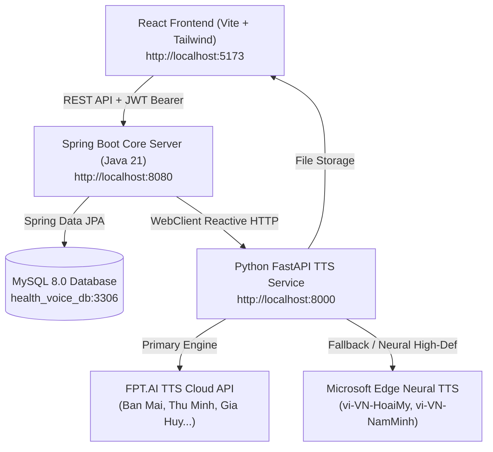

# 🌿 HealthVoice 2.0 - Nghiên Cứu & Tổng Hợp Giọng Nói Trong Tư Vấn Sức Khỏe

Đồ án Công nghệ Phần mềm: **"Nghiên cứu ứng dụng công nghệ tổng hợp và chuyển đổi giọng nói trong xây dựng nội dung tư vấn sức khỏe"**.

Hệ thống hoạt động theo mô hình Client-Server hiện đại, chia tách rõ ràng thành 4 thành phần:
1. **Client (Frontend Web)**: React 18 (Vite) + Tailwind CSS + Lucide Icons + Axios + Web Audio API.
2. **Core Backend Server**: Java 21 + Spring Boot 3.3.4 + Spring Security 6 (Stateless JWT) + Spring Data JPA + MySQL 8.0.
3. **TTS AI Engine Service**: Python 3.11/3.14 (FastAPI) + FPT.AI TTS Cloud API + Microsoft Edge Neural TTS + Bộ chuẩn hóa văn bản y tế chuyên biệt (Regex/NLP rule-based).
4. **Cơ sở dữ liệu**: MySQL 8.0 (`health_voice_db`).

---

## 🏛️ 1. Kiến Trúc Hệ Thống (Architecture Overview)



---

## 🛡️ 2. Hệ Thống Phân Quyền & Bảo Mật (RBAC Matrix)

| Vai Trò | Mã Quyền | Quyền Hạn & Chức Năng Chính |
| :--- | :---: | :--- |
| **Bệnh Nhân / Độc Giả** | `ROLE_LISTENER` / `ROLE_PATIENT` | Truy cập giao diện tư vấn sức khỏe (`/patient`), tương tác chat sinh hiệu, nghe giọng đọc AI, đánh giá chất lượng giọng đọc MOS (1-5 sao), xem lịch sử phiên tư vấn. |
| **Bác Sĩ / Chuyên Viên** | `ROLE_DOCTOR` | Soạn thảo phác đồ/lời khuyên mẫu (`/doctor`), kiểm thử và nghe thử giọng đọc TTS trước khi xuất bản, quản lý từ điển phát âm y khoa (Lexicon), đồng bộ lên Python TTS. |
| **Quản Trị Viên** | `ROLE_ADMIN` | Quản lý người dùng, phân quyền (Promote/Demote), cấu hình API Key FPT.AI, giám sát hiệu năng hệ thống (Latency, Cache Hit Ratio, thống kê điểm MOS). |

### Tài Khoản Thực Tế Trong Database (Mật khẩu mặc định: `123456`)
- **Quản trị viên**: `admin` / `123456`
- **Bác sĩ Tim Mạch**: `bs_tuanminh` (hoặc `bs_nguyentuanminh`) / `123456`
- **Bác sĩ Nhi Khoa**: `bs_lanphuong` (hoặc `bs_tranlanphuong`) / `123456`
- **Người bệnh**: `listener_user` (hoặc `nguyenthimai`) / `123456`

---

## 🗄️ 3. Cơ Sở Dữ Liệu MySQL 8.0 (`health_voice_db`)

1. **`users`**: Quản lý tài khoản, mã hóa BCrypt, liên kết vai trò `role_id`.
2. **`roles`**: Danh mục vai trò (`ROLE_ADMIN`, `ROLE_DOCTOR`, `ROLE_LISTENER`).
3. **`consultation_sessions`**: Phiên tư vấn sức khỏe của người bệnh (`patient_id`, `title`, `status`).
4. **`chat_messages`**: Tin nhắn hội thoại (`sender_type`, `raw_content`, `normalized_content`, `audio_url`, `voice_code`, `latency_ms`, `is_cached`).
5. **`audio_cache`**: Bộ nhớ đệm SHA-256 (`text_hash`, `audio_url`, `voice_code`, `speed`, `file_size`, `hit_count`).
6. **`medical_lexicon`**: Từ điển phát âm y khoa (`raw_term`, `phonetic_replacement`, `category`, `is_active`).
7. **`mos_evaluations`**: Đánh giá thang điểm MOS (`naturalness_score`, `clarity_score`, `tone_score`, `comment`).
8. **`advice_templates`**: Phác đồ dặn dò y tế mẫu của Bác sĩ (`doctor_id`, `title`, `category`, `content`, `audio_url`, `is_public`).
9. **`categories`** & **`voice_configs`**: Chuyên khoa lâm sàng và cấu hình 6 giọng đọc (Ban Mai, Thu Minh, Gia Huy, Mỹ An, Lê Minh, Minh Quang).

---

## 🚀 4. Hướng Dẫn Khởi Động Dự Án

### Cách 1: Khởi động bằng Docker Compose (Khuyến nghị cho chấm đồ án)
Chạy toàn bộ 4 containers chỉ với 1 câu lệnh duy nhất:
```bash
docker compose up --build
```
- Frontend: `http://localhost:80` (hoặc `http://localhost:5173` khi chạy dev)
- Backend API: `http://localhost:8080`
- Python TTS Service: `http://localhost:8000/docs`
- MySQL Database: `localhost:3306`

### Cách 2: Khởi động trực tiếp trên Windows (File `run_all.bat`)
Chỉ cần nhấp đúp vào tệp:
```cmd
run_all.bat
```
Hoặc khởi chạy từng thành phần thủ công:
1. **Python TTS Service**:
   ```bash
   cd tts-service
   pip install -r requirements.txt
   python -m uvicorn main:app --host 0.0.0.0 --port 8000 --reload
   ```
2. **Spring Boot Backend Core**:
   ```bash
   cd health-voice-backend
   .\mvnw.cmd spring-boot:run
   ```
3. **React Frontend**:
   ```bash
   cd health-voice-frontend
   npm run dev
   ```

---

## 🎯 5. Tính Năng Nổi Bật Đạt Điểm Cao Trong Đồ Án

1. **Chuẩn hóa văn bản y tế Tiếng Việt chuyên sâu**:
   - `120/80 mmHg` $\rightarrow$ *"một trăm hai mươi trên tám mươi mi-li-mét thủy ngân"*
   - `SpO2 96%` $\rightarrow$ *"nồng độ ô-xi trong máu chín mươi sáu phần trăm"*
   - `Paracetamol 500mg 1v` $\rightarrow$ *"pa ra xê ta mon năm trăm mi-li-gam một viên"*
   - `> 38.5 độ C` $\rightarrow$ *"trên ba mươi tám phẩy năm độ xê"*
2. **Động cơ âm thanh kép (Dual TTS Engine)**:
   - FPT.AI TTS Cloud v5 (với khả năng nhập custom API Key).
   - Microsoft Edge Neural TTS tích hợp trực tiếp, không bao giờ bị giới hạn hạn mức (Rate limit 429), bảo đảm **100% văn bản nhập vào đều được phát âm chính xác từng từ**.
3. **Bộ nhớ đệm âm thanh SHA-256 (Audio Cache)**:
   - Tối ưu độ trễ xuống dưới 10ms đối với các câu tư vấn lặp lại, tiết kiệm tối đa tài nguyên máy chủ.
4. **Trình phát âm thanh chuyên nghiệp với Waveform & MOS Evaluation**:
   - Điều chỉnh tốc độ 0.75x, 1x, 1.25x.
   - Thanh tiến trình phát sóng âm dạng động.
   - Popup đánh giá chất lượng giọng đọc theo chuẩn quốc tế ITU-T P.800 (Mean Opinion Score).
