# 🏛️ TÀI LIỆU PHÂN TÍCH THIẾT KẾ HỆ THỐNG HƯỚNG ĐỐI TƯỢNG (OOAD) - UML 2.5
## DỰ ÁN: HEALTHVOICE - NỀN TẢNG XUẤT BẢN NỘI DUNG TƯ VẤN SỨC KHỎE & PODCAST GIỌNG ĐỌC AI
*(Chuẩn hóa theo mã nguồn thực tế: Java 21, Spring Boot 3.3.4, React 18, FPT.AI TTS Cloud API, MySQL 8.0)*

---

## MỤC LỤC TỔNG QUAN

1. [PHẦN 1: KẾ HOẠCH BỘ SƠ ĐỒ UML (UML IMPLEMENTATION PLAN)](#phần-1-kế-hoạch-bộ-sơ-đồ-uml-uml-implementation-plan)
2. [PHẦN 2: SƠ ĐỒ USE CASE (USE CASE DIAGRAMS)](#phần-2-sơ-đồ-use-case-use-case-diagrams)
   - 2.1. Sơ đồ Use Case Tổng Quát (General Use Case Diagram)
   - 2.2. Sơ đồ Use Case Phân Rã Nghiệp Vụ Bác Sĩ (Doctor Subsystem)
3. [PHẦN 3: SƠ ĐỒ TUẦN TỰ (SEQUENCE DIAGRAMS - TRUY VẾT LỜI GỌI HÀM)](#phần-3-sơ-đồ-tuần-tự-sequence-diagrams)
   - 3.1. Sequence Diagram: Chuẩn hóa Thuật ngữ & Tổng hợp FPT.AI Async Polling (UC05 & UC06)
   - 3.2. Sequence Diagram: Phát Âm thanh Podcast Streaming HTTP 206 Partial Content (UC08)
   - 3.3. Sequence Diagram: Đánh giá Chất lượng Âm thanh MOS Rating (UC09)
   - 3.4. Sequence Diagram: Xác thực Stateless JWT & Phân quyền RBAC (UC01)
4. [PHẦN 4: SƠ ĐỒ HOẠT ĐỘNG (ACTIVITY DIAGRAMS - PHÂN LÀN SWIMLANES)](#phần-4-sơ-đồ-hoạt-động-activity-diagrams)
   - 4.1. Activity Diagram: Quy trình Soạn thảo, Chuẩn hóa & Xuất bản Podcast Y khoa
   - 4.2. Activity Diagram: Luồng Trải nghiệm Người nghe (Khám phá -> Streaming -> Đánh giá MOS)
5. [PHẦN 5: SƠ ĐỒ LỚP THIẾT KẾ & CƠ SỞ DỮ LIỆU (DESIGN CLASS DIAGRAM & ERD)](#phần-5-sơ-đồ-lớp-thiết-kế--cơ-sở-dữ-liệu)
   - 5.1. Design Class Diagram (Sơ đồ Lớp mức Thiết kế 3 lớp)
   - 5.2. Entity Relationship Diagram (ERD chuẩn 7 bảng CSDL MySQL)

---

# PHẦN 1: KẾ HOẠCH BỘ SƠ ĐỒ UML (UML IMPLEMENTATION PLAN)

| STT | Tên Sơ Đồ | Loại Biểu Đồ (UML Type) | Mục Đích & Phạm Vi Nghiệp Vụ | Tác Nhân Liên Quan | Mã Nguồn Đối Chiếu Trong Codebase |
| :---: | :--- | :---: | :--- | :--- | :--- |
| **01** | **Use Case Tổng Quát** | Use Case Diagram | Mô tả bức tranh tổng thể 10 Use Case cốt lõi của hệ thống và phạm vi tác động của 4 Actor. | `Listener`, `Doctor`, `Admin`, `FPT.AI Cloud` | Toàn bộ các API endpoints trong hệ thống. |
| **02** | **Use Case Bác Sĩ Phân Rã** | Use Case Diagram | Đặc tả chi tiết chu trình nghiệp vụ biên tập bài viết, chuẩn hóa y khoa, thử nghiệm giọng đọc và phát hành podcast. | `Doctor`, `FPT.AI Cloud` | `DoctorStudio.jsx`, `MedicalScriptService`, `TextNormalizationService`. |
| **03** | **Xác Thực Stateless JWT** | Sequence Diagram | Mô tả luồng gửi credentials, mã hóa BCrypt, cấp phát token JWT hạn 24h và lưu giữ tại React Client. | `User`, `ReactFrontend`, `AuthController`, `AuthService`, `JwtTokenProvider` | `AuthController.java`, `AuthServiceImpl.java`, `JwtTokenProvider.java`. |
| **04** | **Chuẩn Hóa & FPT.AI TTS** | Sequence Diagram | **Luồng nghiệp vụ cốt lõi nhất**: Bác sĩ soạn bài -> regex chuẩn hóa số đo/viết tắt -> gửi POST FPT.AI -> vòng lặp Polling tải file MP3 -> lưu ổ cứng -> cập nhật CSDL. | `Doctor`, `ScriptController`, `MedicalScriptService`, `FptAiTtsService`, `FPT.AI Cloud` | `MedicalScriptServiceImpl.java`, `FptAiTtsService.java`, `TextNormalizationService.java`. |
| **05** | **Streaming HTTP 206** | Sequence Diagram | Mô tả cơ chế Web Audio Player gửi Header `Range: bytes=start-end` để nghe podcast mượt mà, hỗ trợ tua nhanh tức thì. | `Listener`, `GlobalAudioPlayer`, `StreamingController`, `FileSystem` | `StreamingController.java`, `GlobalAudioPlayer.jsx`. |
| **06** | **Chấm Điểm MOS Rating** | Sequence Diagram | Mô tả luồng người nghe gửi đánh giá chất lượng giọng đọc (1-5 sao) và hệ thống tính lại điểm trung bình của bài viết. | `Listener`, `AnalyticsController`, `RatingAnalyticsService`, `FeedbackRatingRepository` | `AnalyticsController.java`, `RatingAnalyticsService.java`, `FeedbackRating.java`. |
| **07** | **Quy Trình Xuất Bản Podcast** | Activity Diagram | Sơ đồ phân làn (Swimlanes: Bác sĩ, Backend, FPT.AI Cloud) thể hiện các quyết định (Decision), xử lý lỗi rate-limit 429 và chuyển đổi trạng thái `DRAFT` -> `PROCESSED` -> `PUBLISHED`. | `Doctor`, `Backend Core`, `FPT.AI Cloud` | `MedicalScriptServiceImpl.java`, `FptAiTtsService.java`. |
| **08** | **Trải Nghiệm Độc Giả** | Activity Diagram | Sơ đồ hoạt động thể hiện luồng người nghe tìm kiếm chuyên khoa, streaming podcast và gửi phản hồi trải nghiệm. | `Listener`, `ReactFrontend`, `Backend Core` | `PodcastFeedPage.jsx`, `PodcastDetailPage.jsx`. |
| **09** | **Design Class Diagram** | Class Diagram | Mô hình hướng đối tượng chi tiết bao gồm 7 Entities, Controller, Service, Repository, DTO và các mối quan hệ đa hình. | Hệ thống Backend | Toàn bộ package `entity`, `service`, `controller`, `repository`. |
| **10** | **ERD 7 Bảng CSDL** | Entity Relationship | Mô hình thực thể liên kết chuẩn xác 7 bảng CSDL MySQL với khóa chính (PK), khóa ngoại (FK) và bản số (Cardinality). | Database MySQL | `schema.sql`, `data.sql`, các JPA Annotations. |

---

# PHẦN 2: SƠ ĐỒ USE CASE (USE CASE DIAGRAMS)

## 2.1. Sơ đồ Use Case Tổng Quát (Usecase tổng quát)
*(Chuẩn hóa theo bố cục đối xứng 4 tác nhân: Khách vãng lai & Người dùng ở bên trái, Bác sĩ & Admin ở bên phải, Đăng nhập ở trung tâm, toàn bộ chức năng bảo mật đều có quan hệ `include` trỏ vào Đăng nhập)*

### A. Định dạng PlantUML

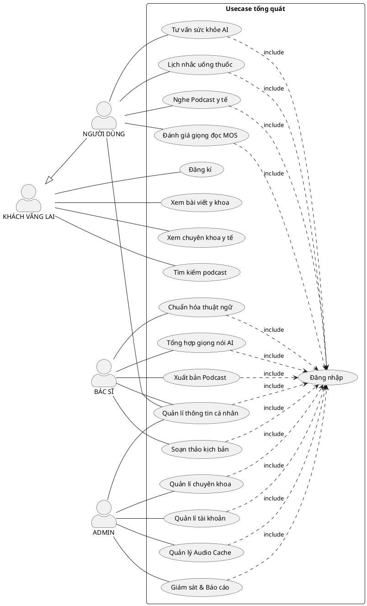

### B. Định dạng Mermaid.js

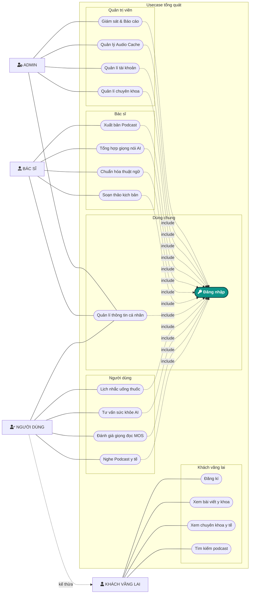

---

## 2.2. Sơ đồ Use Case Phân Rã Nghiệp Vụ Bác Sĩ (Doctor Subsystem)

### A. Định dạng PlantUML

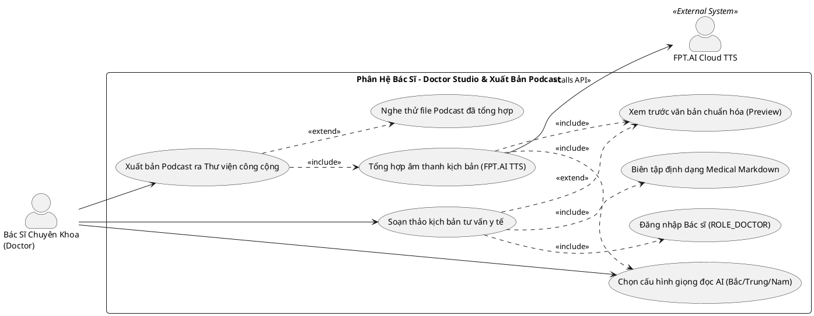

### B. Định dạng Mermaid.js

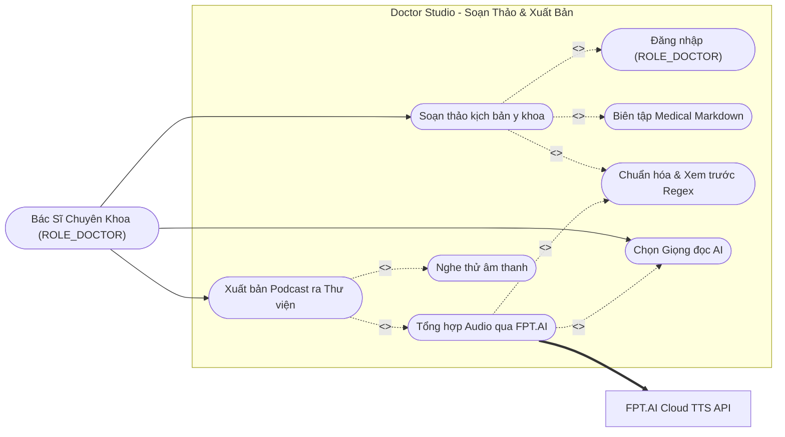

---

# PHẦN 3: SƠ ĐỒ TUẦN TỰ (SEQUENCE DIAGRAMS)

## 3.1. Sequence Diagram: Chuẩn hóa Thuật ngữ & Tổng hợp FPT.AI Async Polling (UC05 & UC06)

> [!IMPORTANT]
> **Điểm đột phá kỹ thuật**: FPT.AI TTS xử lý dạng **Bất Đồng Bộ (Asynchronous)**. Backend gửi văn bản qua POST, nhận lại JSON `{"async": "https://..."}`. Sau đó, `FptAiTtsService` thiết lập vòng lặp Polling (mỗi 1 giây gọi kiểm tra 1 lần, timeout 45 giây) cho đến khi file MP3 render xong thì tải binary stream về lưu đĩa vật lý `./uploads/audios/` và lưu bản ghi `AudioRecord` với trạng thái `READY`.

### A. Định dạng PlantUML

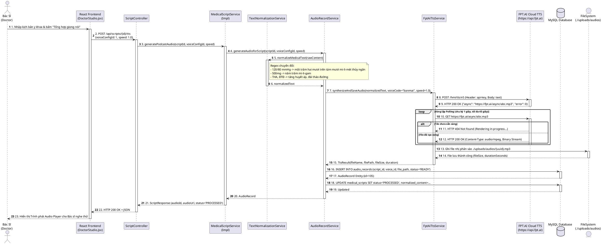

### B. Định dạng Mermaid.js

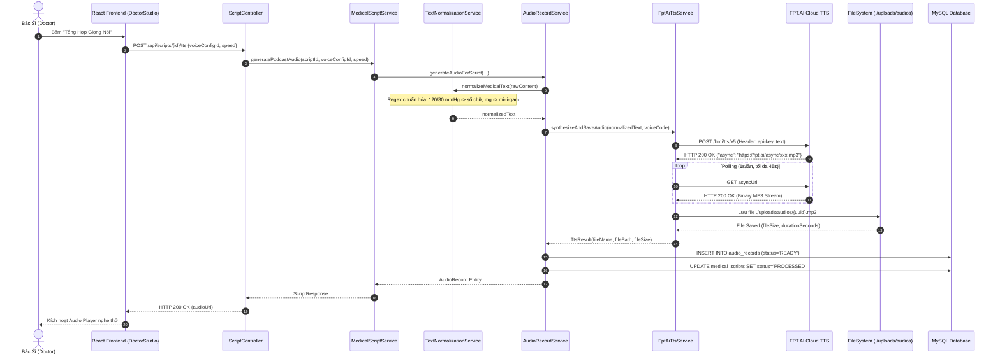

---

## 3.2. Sequence Diagram: Phát Âm thanh Podcast Streaming HTTP 206 Partial Content (UC08)

> [!NOTE]
> Chuẩn **HTTP 206 Partial Content** cho phép chia nhỏ file âm thanh thành các byte-range chunks. Khi người nghe bấm phát, trình duyệt gửi header `Range: bytes=0-1048575`. Khi người nghe tua (seek) đến giữa bài, trình duyệt gửi `Range: bytes=5242880-...`. Máy chủ phản hồi ngay lập tức chunk tương ứng mà không phải tải toàn bộ file từ đầu.

### A. Định dạng PlantUML

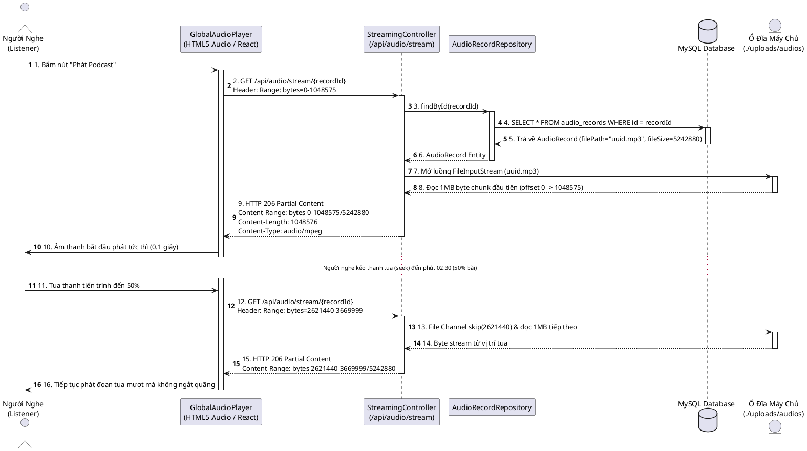

### B. Định dạng Mermaid.js

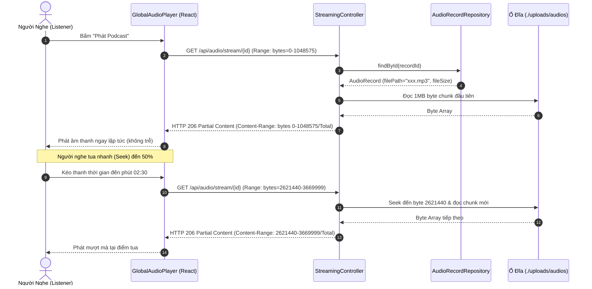

---

## 3.3. Sequence Diagram: Đánh giá Chất lượng Âm thanh MOS Rating (UC09)

### A. Định dạng PlantUML

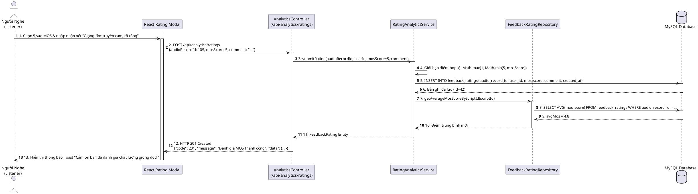

### B. Định dạng Mermaid.js

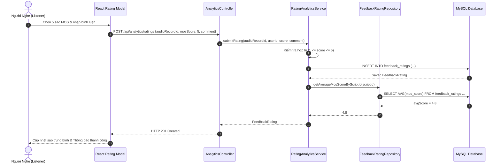

---

## 3.4. Sequence Diagram: Xác thực Stateless JWT & Phân quyền RBAC (UC01)

### A. Định dạng PlantUML

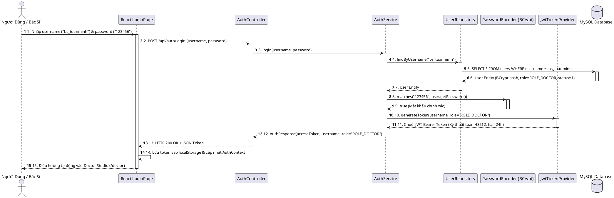

### B. Định dạng Mermaid.js

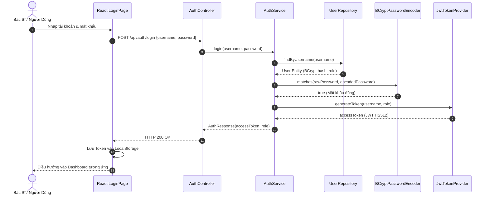

---

# PHẦN 4: SƠ ĐỒ HOẠT ĐỘNG (ACTIVITY DIAGRAMS)

## 4.1. Activity Diagram: Quy trình Soạn thảo, Chuẩn hóa & Xuất bản Podcast Y khoa

### A. Định dạng PlantUML

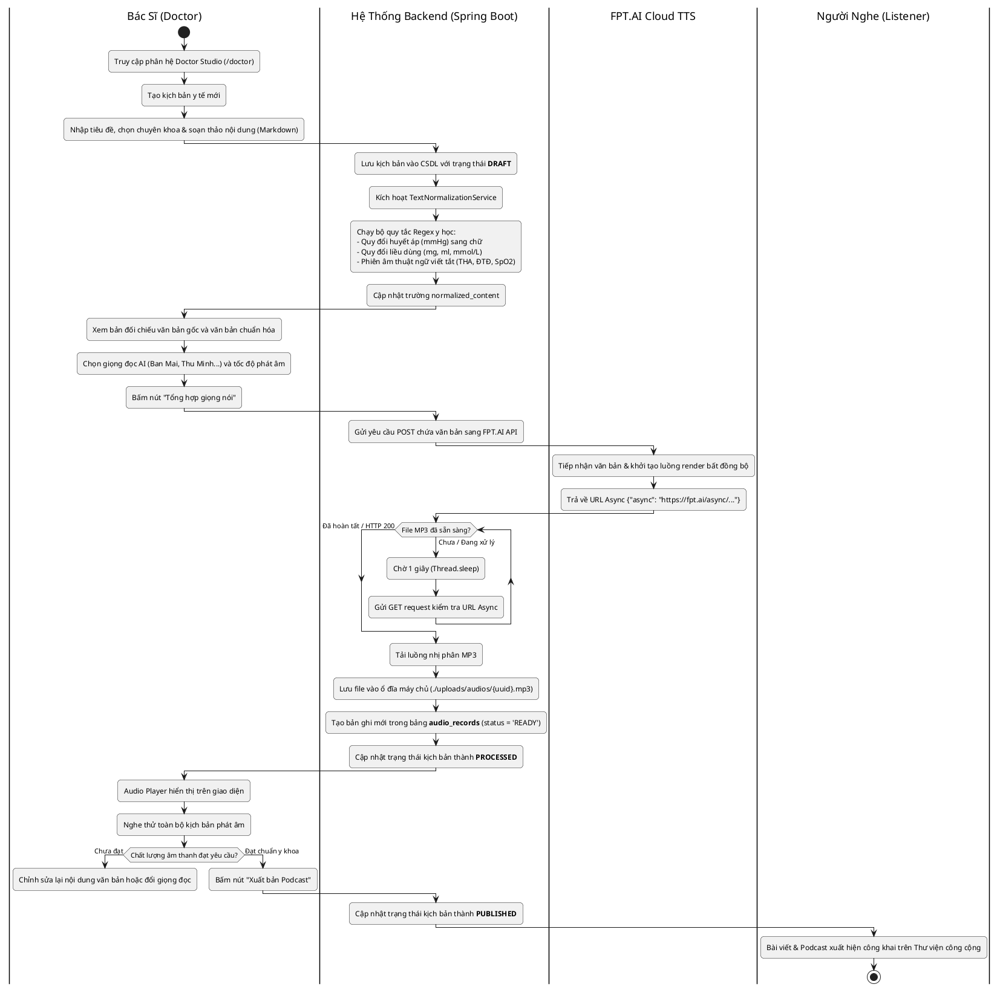

### B. Định dạng Mermaid.js

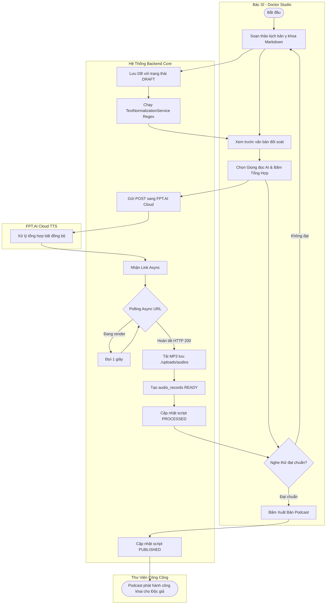

---

## 4.2. Activity Diagram: Luồng Trải nghiệm Người nghe

### A. Định dạng PlantUML

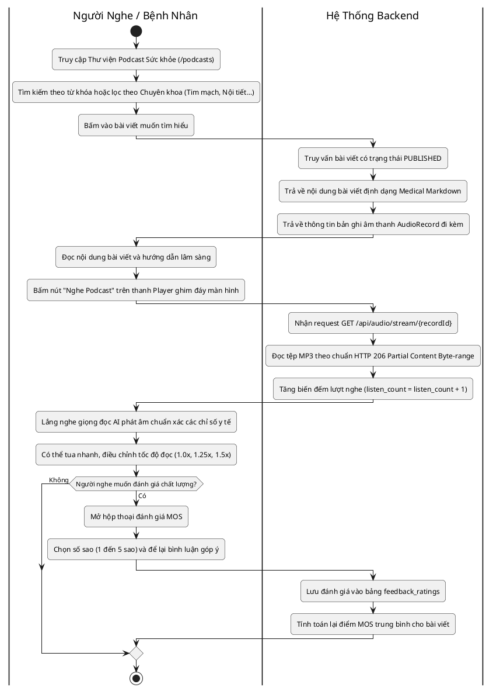

### B. Định dạng Mermaid.js

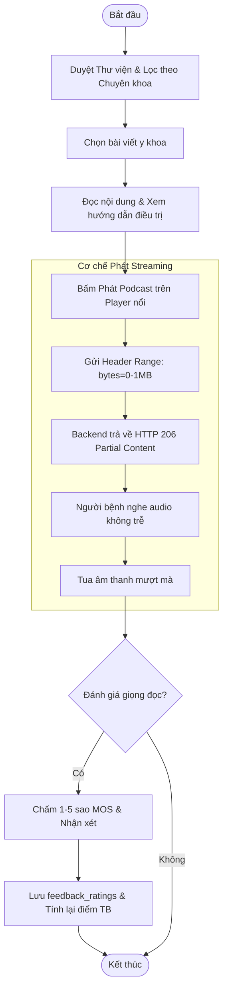

---

# PHẦN 5: SƠ ĐỒ LỚP THIẾT KẾ & CƠ SỞ DỮ LIỆU

## 5.1. Design Class Diagram (Sơ đồ Lớp mức Thiết kế 3 lớp)

Ánh xạ chính xác 100% các Class, Entity, Service và Controller có trong codebase Spring Boot:

### A. Định dạng PlantUML

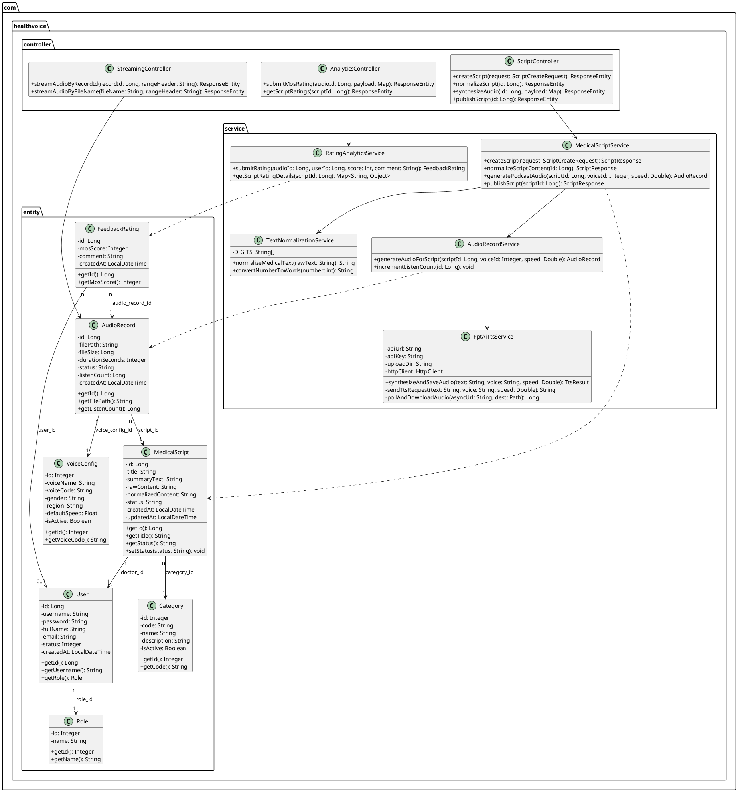

### B. Định dạng Mermaid.js

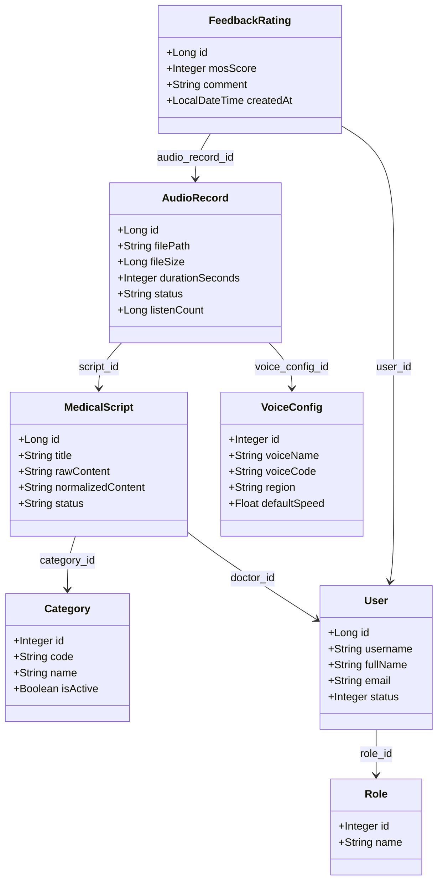

---

## 5.2. Entity Relationship Diagram (ERD chuẩn 7 bảng CSDL MySQL)

### A. Định dạng PlantUML

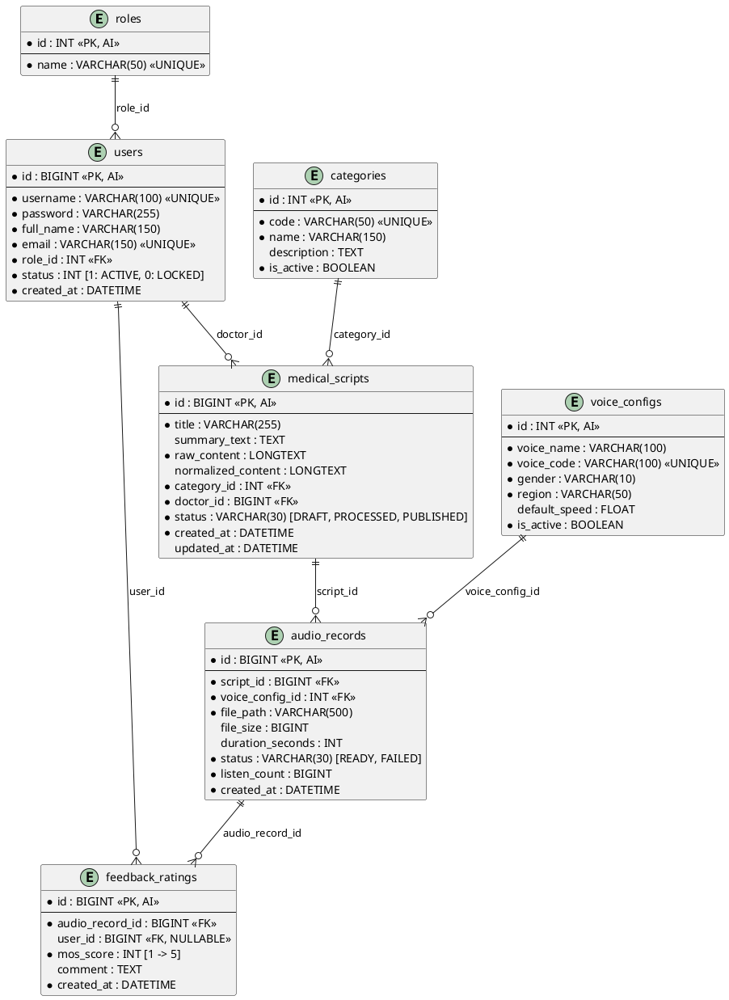

### B. Định dạng Mermaid.js

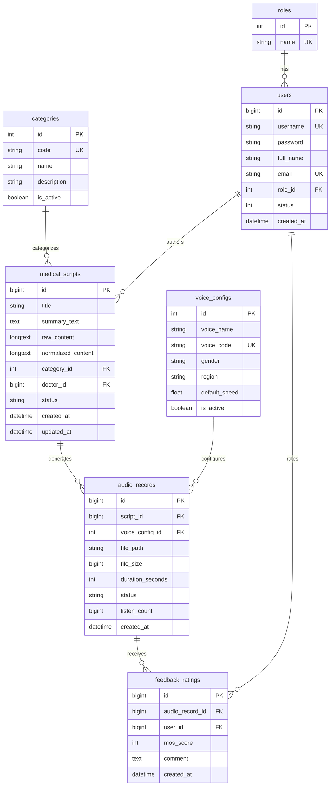

---
*Tài liệu phân tích thiết kế OOAD & UML 2.5 được xây dựng tự động dựa trên quét toàn diện mã nguồn dự án HealthVoice 2.0.*

